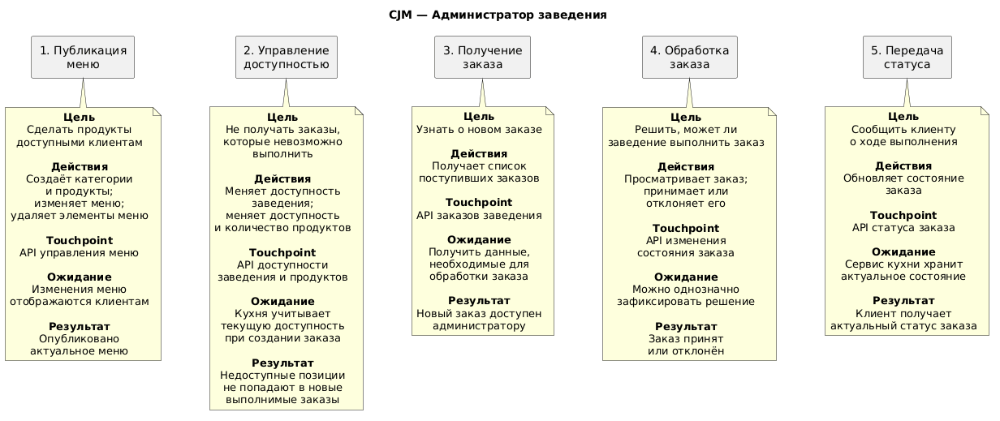
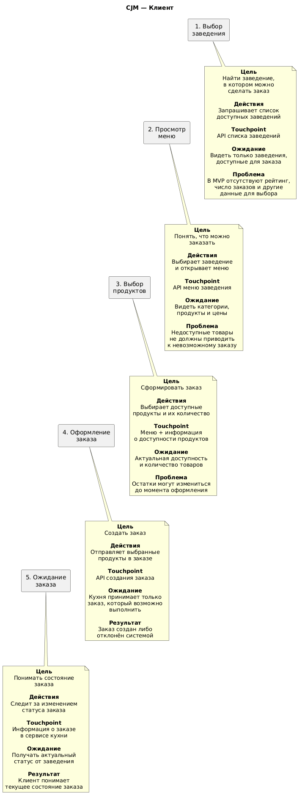
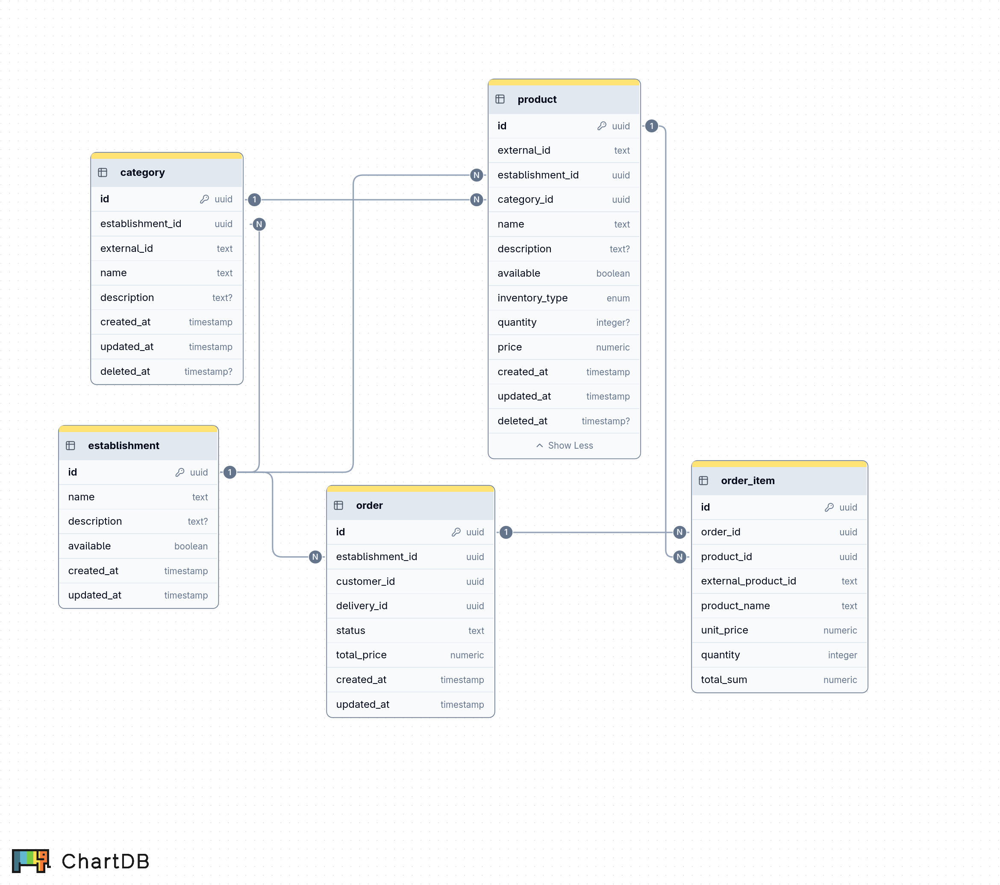
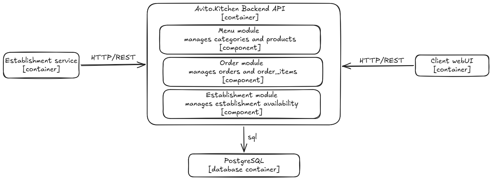

# Авито.Кухня

Сервис для взаимодействия клиентов и заведений общественного питания.

## Заведение

### Пользовательские истории

На основе требований к взаимодействию заведения с сервисом были выделены следующие пользовательские истории:

- Как администратор заведения я хочу опубликовать меню, чтобы покупатели его видели и могли заказать продукты.
- Как администратор заведения я хочу иметь возможность изменять меню.
- Как администратор заведения я хочу получить новые созданные заказы.
- Как администратор заведения я хочу иметь возможность принимать или отклонять поступившие заказы.
- Как администратор заведения я хочу передавать информацию о состоянии заказа, чтобы клиент мог ее видеть.
- Как администратор заведения я хочу управлять доступностью заведения для оформления заказа.
- Как администратор заведения я хочу управлять доступностью конкретного продукта/количеством продукта доступного для заказа.

### Функциональные требования

Из перечисленных пользовательских историй следуют следующие требования к API:

- API должно предоставлять возможность создавать, изменять, удалять меню.
- API должно предоставлять заведению список поступивших заказов.
- API должно предоставлять заведению возможность принять или отклонить заказ.
- API должно предоставлять возможность обновлять статус принятого заказа.
- API должно предоставлять возможность управлять доступностью заведения.
- API должно предоставлять возможность управлять доступностью конкретного продукта.

### Customer Journey Map
[CJM Заведения](docs/cjm/establishment-cjm.puml)


## Клиент

### Пользовательские истории

На основе требований к взаимодействию клиента с сервисом были выделены следующие пользовательские истории:

- Как клиент я хочу видеть доступные заведения, чтобы была возможность выбрать место для заказа.
- Как клиент я хочу видеть меню заведения с ценами и доступными продуктами.
- Как клиент я хочу иметь возможность оформить заказ с выбранными продуктами.
- Как клиент я хочу иметь возможность отменить заказ. 

### Функциональные требования

Из перечисленных пользовательских историй следуют следующие требования к API:

- API должно предоставлять доступные заведения.
- API должно предоставлять меню конкретного заведения.
- API должно оформлять заказ из конкретного заведения.
- API должно отменять заказ.

### Customer Journey Map
[CJM Клиента](docs/cjm/client-cjm.puml)



## Бизнес правила

Заказ может быть создан только если:

1. Заведение доступно для заказов.
2. Все продукты существуют и не удалены.
3. Все продукты относятся к выбранному заведению.
4. Все продукты доступны.
5. Для продуктов с ограниченным остатком запрошенное количество не превышает `quantity`.
6. Цена заказа не принимается от клиента и рассчитывается сервисом на основании актуальных цен продуктов в момент создания заказа.

Клиент может отменть заказ только если, он еще не был принят заведением.

Статус заказа имеет следующий жизненный цикл:
```
created ──→ accepted ──→ preparing ──→ ready ──→ completed
   │
   ├──→ rejected
   │
   └──→ cancelled
```

Тип учета остатков продукта (inventory type) имеет два значения: `finite` и `unlimited`. 
`finite` предполагает товар в ограниченном количестве, например, багет из пекарни, продукт с таким типом имеет определенное количество штук (quantity is not null).
`unlimited` предполагает, что товар приготовляется на заказ и соответственно не имеет ограниченного количесвта.

## Проектирование API
API спроектировано на основании перечисленных выше пользовательских сценариев и функциональных требований.

Эндпоинты разделены на "партнерские", предназначеные для заведений, и клиентские, которые будут использовать клиенты сервисы Авито.Кухня.

Контракт API описан в формате OpenAPI:
[Контракт API](docs/api/openapi.yaml)

## Проектирование схемы данных

В модели данных выделено пять сущностей.

### Заведение

| Атрибут     | Тип                      | Значение                                    |
| ----------- | ------------------------ | ------------------------------------------- |
| id          | uuid                     | Уникальный идентификатор заведения          |
| name        | text                     | Название заведения                          |
| description | text                     | Описание заведения                          |
| available   | boolean                  | Доступность заведения для оформления заказа |
| created_at  | timestamp with time zone | Дата и время создания записи                |
| updated_at  | timestamp with time zone | Дата и время последнего обновления записи   |

### Категория

Сущности категория и продукт составляют собой меню.

| Атрибут          | Тип                      | Значение                                                                   |
| ---------------- | ------------------------ | -------------------------------------------------------------------------- |
| id               | uuid                     | Уникальный идентификатор категории                                         |
| establishment_id | uuid                     | Идентификатор заведения, которому принадлежит категория                    |
| external_id      | text                     | Идентификатор категории во внешней системе заведения                       |
| name             | text                     | Название категории                                                         |
| description      | text                     | Описание категории                                                         |
| created_at       | timestamp with time zone | Дата и время создания записи                                               |
| updated_at       | timestamp with time zone | Дата и время последнего обновления записи                                  |
| deleted_at       | timestamp with time zone | Дата и время мягкого удаления категории. `NULL`, если категория не удалена |

### Продукт

| Атрибут          | Тип                      | Значение                                                                                |
| ---------------- | ------------------------ | --------------------------------------------------------------------------------------- |
| id               | uuid                     | Уникальный идентификатор продукта                                                       |
| external_id      | text                     | Идентификатор продукта во внешней системе заведения                                     |
| establishment_id | uuid                     | Идентификатор заведения, которому принадлежит продукт, избыточен, но необходим для гарантии уникальности external_id в одном заведении |
| category_id      | uuid                     | Идентификатор категории, к которой относится продукт                                    |
| name             | text                     | Название продукта                                                                       |
| description      | text                     | Описание продукта                                                                       |
| available        | boolean                  | Доступность продукта для заказа                                                         |
| inventory_type_id| integer                  | Тип учёта остатков продукта                                                             |
| quantity         | integer                  | Доступное количество продукта. Может отсутствовать в зависимости от типа учёта остатков |
| price            | numeric                  | Текущая цена продукта                                                                   |
| created_at       | timestamp with time zone | Дата и время создания записи                                                            |
| updated_at       | timestamp with time zone | Дата и время последнего обновления записи                                               |
| deleted_at       | timestamp with time zone | Дата и время мягкого удаления продукта. `NULL`, если продукт не удалён                  |

### Тип учета остатков продукта

| Атрибут        | Тип     | Значение                                                               |
| -------------- | ------- | ---------------------------------------------------------------------- |
| id             | integer | Уникальный идентификатор типа учёта остатков продукта                  |
| inventory_type | text    | Тип учёта остатков продукта. Возможные значения: `finite`, `unlimited` |

### Заказ

| Атрибут     | Тип       | Значение                                  |
| ----------- | --------- | ----------------------------------------- |
| id          | uuid      | Уникальный идентификатор заказа           |
| establishment_id | uuid | Идентификатор заведения, которому принадлежит категория|
| customer_id | uuid      | Идентификатор клиента, создавшего заказ   |
| delivery_id | uuid      | Идентификатор доставки заказа             |
| status_id   | integer   | Текущий статус заказа                     |
| total_price | numeric   | Итоговая стоимость заказа                 |
| created_at  | timestamp | Дата и время создания заказа              |
| updated_at  | timestamp | Дата и время последнего обновления заказа |

### Статус заказа

| Атрибут | Тип     | Значение                                                                                                                  |
| ------- | ------- | ------------------------------------------------------------------------------------------------------------------------- |
| id      | integer | Уникальный идентификатор статуса заказа                                                                                   |
| status  | text    | Код статуса заказа. Возможные значения: `created`, `accepted`, `rejected`, `cancelled`, `preparing`, `ready`, `completed` |

### Продукт заказа

Используется отдельная сущность, а не просто ссылка на товар, для сохранения данных о заказе, при изменении данных о продукте.

| Атрибут             | Тип     | Значение                                                                        |
| ------------------- | ------- | ------------------------------------------------------------------------------- |
| id                  | uuid    | Уникальный идентификатор позиции заказа                                         |
| order_id            | uuid    | Идентификатор заказа, к которому относится позиция                              |
| product_id          | uuid    | Идентификатор продукта                                                          |
| external_product_id | text    | Идентификатор продукта во внешней системе заведения на момент оформления заказа |
| product_name        | text    | Название продукта на момент оформления заказа                                   |
| unit_price          | numeric | Цена одной единицы продукта на момент оформления заказа                         |
| quantity            | integer | Количество единиц продукта в заказе                                             |
| total_sum           | numeric | Итоговая стоимость позиции заказа                                               |

### Общая схема данных



### Файлы миграций

Файлы миграций представлены в директории kitchen/migrations/schemes

[Файлы миграций](kitchen/migrations/schemes)

## Архитектура приложения

Архитектура представляет собой модульный монолит, основные модули:
1. Модуль заведения - отвечает за создание заведения, обновления доступности заведения.
2. Модуль меню - отвечает за создание, изменение, удаление категорий и продуктов, предоставление данных о доступных категориях и продуктов клиенту.
3. Модуль заказа - отвечает за создание заказа, обновление статуса заказа, предоставление данных о новых заказах заведению.

### Особенности реализации

- Для юнит-тестирования мок-зависимости генерировались с помощью mockery;
- Для реализация слоя доступа к данным БД использовался sqlc;
- Для миграций базы данных использовался goose.

### C4 level3



## Ограничения MVP

В рамках MVP не реализованы:

- расписание работы заведений;
- географическая доступность;
- персонализация и предпочтения пользователя;
- рейтинг заведений;
- статистика количества заказов.

Доступность заведения явно задаётся самим заведением.

Не рассматривались: 
- Модуль доставки;
- Модуль пользователя.

## Запуск и тестирование

```bash
git clone https://github.com/talense-tasks/backend-trainee-assignment-autumn-2026-tyulenb-7224f74f.git
cd backend-trainee-assignment-autumn-2026-tyulenb-7224f74f
docker compose up --build
```

Приложение готово к тестированию со стороны клиента, доступно по адресу http://localhost:8080
